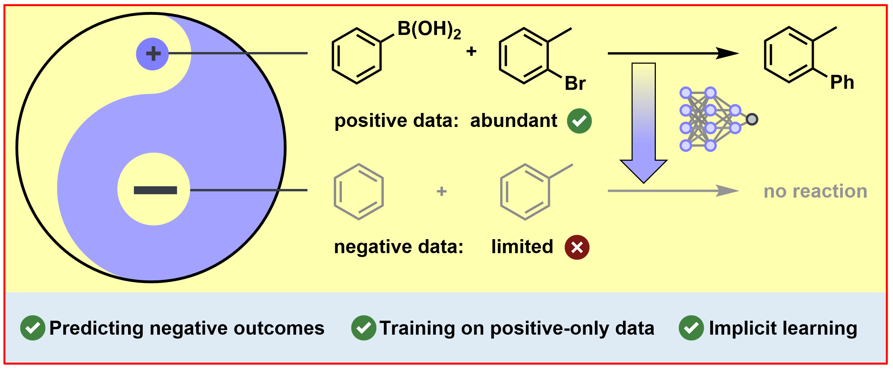

<div align="center">

# TACIT

**TAckling Chemistry through ImpliciT negative learning**

Nick Wierich\*, Niklas Dobberstein\*, Frank Glorius†

*Organisch-Chemisches-Institut, Universität Münster, 48149 Münster, Germany*

<sub>\* These authors contributed equally. &nbsp;·&nbsp; † Corresponding author.</sub>



[Project page](https://gloriusgroup.github.io/tacit/) · [Models and data (Zenodo)](https://doi.org/10.5281/zenodo.23669984) · [Paper](#citation)

</div>

---

## Abstract

Machine learning models for reaction product prediction have largely been
trained and evaluated on datasets of successful reactions. While this setting
allows reaching high accuracy scores, these models generally struggle to
discriminate between successful and unsuccessful transformations due to the
lack of negative training data. This critically limits their practical use, as
reliably recognizing unproductive substrate combinations *in silico* is
required to accelerate experimental campaigns and save resources in the
laboratory. While the availability of negative reaction data remains limited to
date, we show that even purely positive datasets implicitly contain a
significant amount of information about cases in which no reaction occurs. To
exploit this, we introduce TACIT (TAckling Chemistry through ImpliciT negative
learning). While trained on positive-only data, TACIT learns to distinguish
between productive and unproductive transformations. On two published
high-throughput experimentation datasets, it outperforms all evaluated reaction
outcome prediction models in separating successful from failed reactions.
Crucially, TACIT's accuracy on the popular USPTO-MIT benchmark remains
competitive, despite its added ability to predict negative reaction outcomes.

## Results

| Model | USPTO-MIT top-1 [%] | [Chemlex](https://doi.org/10.1038/s41467-025-59812-0) ROC-AUC / PR-AUC | [AIChemEco](https://doi.org/10.1039/d5sc03364k) ROC-AUC / PR-AUC |
|---|---|---|---|
| TACIT | 77.8 | **0.80** / **0.56** | **0.61** / **0.69** |
| [MEGAN](https://doi.org/10.1021/acs.jcim.1c00537)<sup>a</sup> | 80.5 | 0.69 / 0.38 | 0.47 / 0.56 |
| [FlowER](https://doi.org/10.1038/s41586-025-09426-9)<sup>b</sup> | 42.8 | 0.50 / 0.26 | 0.51 / 0.60 |
| [Molecular Transformer](https://doi.org/10.1021/acscentsci.9b00576)<sup>a,d</sup> | 81.7 | 0.68 / 0.42 | 0.51 / 0.61 |
| [LocalTransform](https://doi.org/10.1038/s42256-022-00526-z)<sup>a,d</sup> | 80.4 | 0.64 / 0.37 | 0.51 / 0.59 |
| [ReactionT5](https://doi.org/10.1186/s13321-025-01075-4)<sup>a,c,d</sup> | **95.1**<sup>e</sup> | 0.69 / 0.41 | 0.47 / 0.58 |

USPTO-MIT: all 40,000 test reactions. HTE datasets: all 11,669 (Chemlex) and
47,015 (AIChemEco) wells. A well is positive if its conversion or yield is at
least 20%, and negative otherwise.

<sup>a</sup> Retrained on the blockspace-filtered USPTO-MIT training set used for TACIT.<br>
<sup>b</sup> Published checkpoint. Not retrained, since a mechanistic dataset is required for training.<br>
<sup>c</sup> Pretrained on the Open Reaction Database.<br>
<sup>d</sup> No stop action. The confidence of the top-1 prediction is used as the score.<br>
<sup>e</sup> 34,552 of the 40,000 test reactions (86.4%) are contained in the ORD pretraining data. The top-1 accuracy is 97.5% on these and 80.4% on the remaining 5,448 reactions.

## Installation

Requires **Python 3.11** and a CUDA 12.4 environment. The project uses
[uv](https://docs.astral.sh/uv/).

```bash
git clone https://github.com/GloriusGroup/tacit.git && cd tacit

uv sync
```

## Models and data

The checkpoints and the dataset are archived on
[Zenodo](https://doi.org/10.5281/zenodo.23669984):

| File | Content | Place at |
|---|---|---|
| `tacit.pt` | TACIT weights (base model) | `runs/tacit/checkpoints/` |
| `tacit_no-stop.pt` | TACIT<sub>no-stop</sub> weights (trained without the auxiliary stop loss) | `runs/tacit_no-stop/checkpoints/` |
| `uspto_mit_blockspace.zip` | USPTO-MIT train, validation and test splits with blockspace decompositions | `data/uspto_mit/` |

```bash
unzip -j uspto_mit_blockspace.zip '*.jsonl' -d data/uspto_mit
```

Both checkpoints are the final models after 50 epochs, without any checkpoint
selection. The configs in `runs/<name>/config.yaml` are the ones used for
training. The archive's README describes the data fields and the blockspace
filter (`success` and 1 to 4 elementary steps) that selects the 334,510 training
reactions.

### Recreating the training data

The data is computed from the original USPTO-MIT splits of
[Jin et al. (2017)](https://github.com/wengong-jin/nips17-rexgen/tree/master/USPTO).
Unzip their `data.zip`, take the reaction SMILES column of each split and run
`batch.py` on it from the repository root.

```bash
unzip data.zip -d jin && (echo rxn_smiles; cut -d' ' -f1 jin/data/test.txt) > test.csv
```
```bash
uv run python src/bond_match/blockspace/batch.py test.csv -c rxn_smiles -o test.jsonl --strict --mixed --remove_stereo --clean-coo -w 32 -t 10
```

The Zenodo record also contains the retrained baseline models (MEGAN, Molecular
Transformer, LocalTransform and ReactionT5), each with its upstream license and
a note on how it was trained.

## Usage

### USPTO-MIT

```bash
uv run python src/bond_match/evaluate_ranking.py --config runs/tacit/config.yaml --checkpoint runs/tacit/checkpoints/tacit.pt --data data/uspto_mit/test.jsonl --all-entries --save-csv tacit_uspto.csv
```

`--all-entries` evaluates all 40,000 test reactions. Reactions that fail the
blockspace filter are predicted from their reaction SMILES alone. The last line
reports the top-1 accuracy over all entries. Without `--all-entries`, only the
32,860 test reactions that pass the filter are evaluated. On one NVIDIA Quadro
RTX 6000, the full test set takes about 45 minutes.

### HTE datasets

The HTE datasets are not redistributed here. Download them from the original
authors and convert each into a `wells.csv`:

| Dataset | Source file | License |
|---|---|---|
| Chemlex ([Zhong et al., *Nat. Commun.* 2025](https://doi.org/10.1038/s41467-025-59812-0)) | [`Chemlex_Acidamine_Wetlab_Data.xlsx`](https://zenodo.org/records/17596563/files/Chemlex_Acidamine_Wetlab_Data.xlsx) (Zenodo, version of Nov 2025) | CC BY-NC 4.0 |
| AIChemEco ([Zhang et al., *Chem. Sci.* 2025](https://doi.org/10.1039/d5sc03364k)) | [`all_HTE_with_condition.csv`](https://raw.githubusercontent.com/aichemeco/amide_coupling/fa29d551e732c22186a158b536d0579cf40cc03a/data/all_HTE_with_condition.csv) (GitHub, commit `fa29d55`) | MIT |

```bash
uv run python src/bond_match/hte_wells.py chemlex Chemlex_Acidamine_Wetlab_Data.xlsx chemlex.csv
```
```bash
uv run python src/bond_match/hte_wells.py aichemeco all_HTE_with_condition.csv aichemeco.csv
```

Each row of `wells.csv` is one well: a `reaction_smiles` column with all species
of the well (substrates, coupling reagent, additive, base and solvent) and the
expected product, as `reactants>>product`, plus the label column
(`conversion_pct` for Chemlex, `yield_pct` for AIChemEco). Then score the wells:

```bash
uv run python src/bond_match/score_hte.py --config runs/tacit/config.yaml --checkpoint runs/tacit/checkpoints/tacit.pt --wells chemlex.csv --label-column conversion_pct --out tacit_chemlex.csv
```

The script prints ROC-AUC, PR-AUC and the share of positive wells with the
correct top-1 product. For AIChemEco, use `--wells aichemeco.csv --label-column yield_pct`.

### Interactive prediction

Without `--data`, the evaluator opens an interactive menu:

1. Enter custom reaction SMILES for prediction.
2. Evaluate the test set from the config.
3. Evaluate a random sample from the test set and print detailed prediction
   information.

Option 3 prints the ranked actions of each step:
```txt
=== Ranking Model Eval Menu ===
1. Interactive SMILES Prediction (Top 5)
2. Evaluate on Test Set (test.jsonl)
3. Random Sample from Test Set (Visual)
q. Quit
Select option: 3

Chosen Reaction: [Br:1][c:2]1[cH:3][cH:4][c:5]([F:22])[c:6]([CH:8]([C:9]([CH2:10][O:11][Si:12]([CH3:13])([CH3:14])[C:15]([CH3:16])([CH3:17])[CH3:18])([F:19])[F:20])[OH:21])[cH:7]1.[Cl:44][CH2:45][Cl:46].[Cr:23]([O:24][Cr:25]([O-:26])(=[O:27])=[O:28])([O-:29])(=[O:30])=[O:31].[nH+:32]1[cH:33][cH:34][cH:35][cH:36][cH:37]1.[nH+:38]1[cH:39][cH:40][cH:41][cH:42][cH:43]1>>[Br:1][c:2]1[cH:3][cH:4][c:5]([F:22])[c:6]([C:8]([C:9]([CH2:10][O:11][Si:12]([CH3:13])([CH3:14])[C:15]([CH3:16])([CH3:17])[CH3:18])([F:19])[F:20])=[O:21])[cH:7]1

--- Initial Step Analysis for: CC(C)(C)[Si](C)(C)OCC(F)(F)C(O)c1cc(Br)ccc1F.ClCCl.[O]=[Cr](=[O])([O-])[O][Cr](=[O])(=[O])[O-].c1cc[nH+]cc1.c1cc[nH+]cc1 ---
Rank  Score    Prob     Action          Match?
----------------------------------------------------------------------
1     20.4063   100.00   H#0-O:21 | H#29-C:8 ✅ 0 (0: 96%, 1: 4%)
2     3.1983   0.00   H#29-C:8 | O:30-Cr:23 ❌ 1 (0: 5%, 1: 95%)
3     2.6605   0.00   H#16-C:45 | H#29-C:8 ❌ 1 (0: 17%, 1: 83%)
4     2.5527   0.00   O:30-Cr:23 | O:24-Cr:23 ❌ 1 (0: 6%, 1: 94%)
5     1.9780   0.00   H#27-C:10 | H#29-C:8 ❌ 0 (0: 96%, 1: 4%)

--- Final Result ---
Steps applied: 1
Stop reason: Model selected is_over stop action
Top-1 Correct? True
```

### Training

```bash
uv run bash run_train_multigpu.sh runs/tacit/config.yaml 4
```

The paper models were trained on 4 GPUs with 16 reactions per GPU (effective
batch size 64) for 50 epochs. The final model is written to
`runs/<name>/checkpoints/<name>.pt`. After each epoch the model is evaluated on
the validation split. These metrics are only logged and are not used to select a
checkpoint.

## Repository layout

```
src/bond_match/
├── train_ranking.py        # training entry point (training/ package, DDP and single GPU)
├── evaluate_ranking.py     # evaluation entry point (evaluation/ package, batch and interactive)
├── hte_wells.py            # converts the published HTE files into wells.csv
├── score_hte.py            # HTE well scoring and metrics
├── training/               # trainer, EMA, DDP, loss and optimizer helpers
├── evaluation/             # evaluator, BE-step operations, inference data, SMILES utilities
├── model/                  # BondGAT encoder, Transformer, heads, scorers
├── modules/                # MoE, attention residuals, LoRA, Muon optimizer, mHC
├── losses/                 # pair-ranking and energy-based losses
├── blockspace/             # Bond-Electron matrix algebra, reaction decomposition, batch.py
├── dataset/                # sharded dataset: molecular graphs, reaction processing, collate
├── config.py               # RankingConfig schema and YAML loader
└── sampler.py              # shard-aware and weighted sampling
runs/                       # config.yaml per model (checkpoints/ from Zenodo)
data/uspto_mit/             # dataset files (from Zenodo)
docs/                       # project page (GitHub Pages)
```

## Citation

```bibtex
@article{tacit,
  title  = {Implicit Learning: Reaction Outcome Prediction from Positive-Only Data},
  author = {Wierich, Nick and Dobberstein, Niklas and Glorius, Frank},
  year   = {2026},
  note   = {TACIT: TAckling Chemistry through ImpliciT negative learning}
}
```

## License

The code, the TACIT checkpoints and the data on Zenodo are released under the
MIT License (see `LICENSE`). The USPTO-MIT splits are by
[Jin et al. (2017)](https://github.com/wengong-jin/nips17-rexgen) and were
released under the MIT License. The retrained baseline models keep their
upstream licenses.
