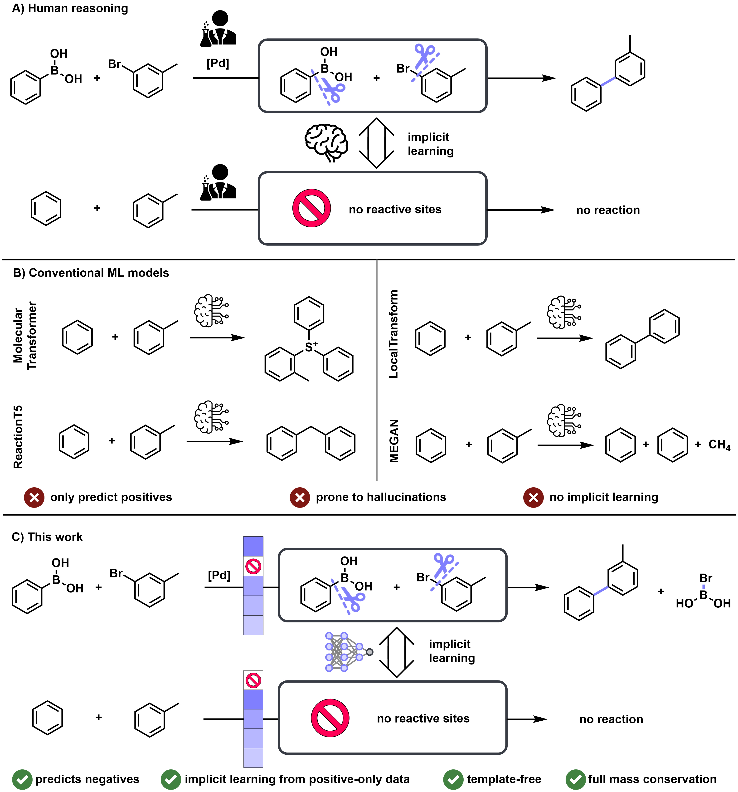

<div align="center">

# TACIT

**TAckling Chemistry through ImpliciT negative learning**

Nick Wierich\*, Niklas Dobberstein\*, Frank Glorius†

*Organisch-Chemisches-Institut, Universität Münster, 48149 Münster, Germany*

<sub>\* These authors contributed equally. &nbsp;·&nbsp; † Corresponding author.</sub>

Reaction outcome prediction at the level of elementary mechanistic steps, trained
on positive reactions only while retaining the ability to predict *no reaction*.



[Project page](https://gloriusgroup.github.io/tacit/) · [Models and data (Zenodo)](https://doi.org/10.5281/zenodo.23669984) · [Paper](#citation)

</div>

---

## Overview

TACIT predicts reaction outcomes by ranking **bond pairs**. At each elementary
step, it selects two bonds to break and two bonds to form, or a **stop action**
when no further step is predicted. Because every unchanged bond pair of a
positive reaction acts as an implicit negative during training, the model learns
to distinguish productive from unproductive transformations from positive-only
data.

Both models are trained on the blockspace-filtered USPTO-MIT training set and
evaluated on the full, unfiltered test sets. TACIT is trained with the auxiliary
stop loss, TACIT<sub>no-stop</sub> without it.

| | USPTO-MIT top-1 | Chemlex ROC-AUC / PR-AUC | AIChemEco ROC-AUC / PR-AUC |
|---|---|---|---|
| TACIT | 77.8% | 0.80 / 0.56 | 0.61 / 0.69 |
| TACIT<sub>no-stop</sub> | 80.4% | 0.67 / 0.35 | 0.53 / 0.59 |

USPTO-MIT: all 40,000 test reactions. HTE datasets: all 11,669 (Chemlex) and
47,015 (AIChemEco) wells, scored by 1 − P(stop) before the first step. A well is
positive if its conversion or yield is at least 20%.

## Installation

Requires **Python 3.11** and a CUDA 12.4 environment. The project uses
[uv](https://docs.astral.sh/uv/).

```bash
git clone https://github.com/GloriusGroup/tacit.git && cd tacit

uv sync

uv pip install pyg_lib torch_scatter torch_sparse torch_cluster torch_spline_conv -f https://data.pyg.org/whl/torch-2.6.0+cu124.html
```

## Models and data

The checkpoints and the dataset are archived on
[Zenodo](https://doi.org/10.5281/zenodo.23669984):

| File | Content | Place at |
|---|---|---|
| `tacit.pt` | TACIT weights | `runs/tacit/checkpoints/` |
| `tacit_no-stop.pt` | TACIT<sub>no-stop</sub> weights | `runs/tacit_no-stop/checkpoints/` |
| `uspto_mit_blockspace.zip` | USPTO-MIT train, validation and test splits with blockspace decompositions | `data/uspto_mit/` |

Both checkpoints are the final models after 50 epochs, without any checkpoint
selection. The configs in `runs/<name>/config.yaml` are the ones used for
training. The archive's README describes the data fields and the blockspace
filter (`success` and 1 to 4 elementary steps) that selects the 334,510 training
reactions.

The Zenodo record also contains the retrained baseline models (MEGAN, Molecular
Transformer, LocalTransform and ReactionT5), each with its upstream license and
a note on how it was trained.

## Usage

### USPTO-MIT

```bash
python src/bond_match/evaluate_ranking.py --config runs/tacit/config.yaml \
  --checkpoint runs/tacit/checkpoints/tacit.pt \
  --data data/uspto_mit/test.jsonl --all-entries --save-csv tacit_uspto.csv
```

`--all-entries` evaluates all 40,000 test reactions. Reactions that fail the
blockspace filter are predicted from their reaction SMILES alone. The last line
reports the top-1 accuracy over all entries. Without `--all-entries`, only the
32,860 test reactions that pass the filter are evaluated. On one NVIDIA Quadro
RTX 6000, the full test set takes about 45 minutes.

### HTE datasets

```bash
python src/bond_match/score_hte.py --config runs/tacit/config.yaml \
  --checkpoint runs/tacit/checkpoints/tacit.pt \
  --wells wells.csv --label-column conversion_pct --out tacit_scores.csv
```

`wells.csv` holds one well per row: a `reaction_smiles` column with all species
of the well (substrates, coupling reagent, additive, base and solvent) and the
expected product, as `reactants>>product`, plus the label column (conversion or
yield in %). The script prints ROC-AUC, PR-AUC and the share of positive wells
with the correct top-1 product. The HTE datasets are not redistributed here.
They are available from their original publications, Chemlex
([Zhong et al., *Nat. Commun.* 2025](https://doi.org/10.1038/s41467-025-59812-0))
and AIChemEco
([Zhang et al., *Chem. Sci.* 2025](https://doi.org/10.1039/d5sc03364k)). The
paper's SI describes how the wells are converted to reaction SMILES.

### Interactive prediction

Without `--data`, the evaluator opens an interactive menu:

1. Enter custom reaction SMILES for prediction.
2. Evaluate the test set from the config.
3. Evaluate a random sample from the test set and print detailed prediction
   information.

Option 3 prints the ranked actions of each step:
```txt
=== Ranking Model Eval Menu ===
1. Interactive SMILES Prediction (Top 5)
2. Evaluate on Test Set (test.jsonl)
3. Random Sample from Test Set (Visual)
q. Quit
Select option: 3

Chosen Reaction: [Br:1][c:2]1[cH:3][cH:4][c:5]([F:22])[c:6]([CH:8]([C:9]([CH2:10][O:11][Si:12]([CH3:13])([CH3:14])[C:15]([CH3:16])([CH3:17])[CH3:18])([F:19])[F:20])[OH:21])[cH:7]1.[Cl:44][CH2:45][Cl:46].[Cr:23]([O:24][Cr:25]([O-:26])(=[O:27])=[O:28])([O-:29])(=[O:30])=[O:31].[nH+:32]1[cH:33][cH:34][cH:35][cH:36][cH:37]1.[nH+:38]1[cH:39][cH:40][cH:41][cH:42][cH:43]1>>[Br:1][c:2]1[cH:3][cH:4][c:5]([F:22])[c:6]([C:8]([C:9]([CH2:10][O:11][Si:12]([CH3:13])([CH3:14])[C:15]([CH3:16])([CH3:17])[CH3:18])([F:19])[F:20])=[O:21])[cH:7]1

--- Initial Step Analysis for: CC(C)(C)[Si](C)(C)OCC(F)(F)C(O)c1cc(Br)ccc1F.ClCCl.[O]=[Cr](=[O])([O-])[O][Cr](=[O])(=[O])[O-].c1cc[nH+]cc1.c1cc[nH+]cc1 ---
Rank  Score    Prob     Action          Match?
----------------------------------------------------------------------
1     20.4063   100.00   H#0-O:21 | H#29-C:8 ✅ 0 (0: 96%, 1: 4%)
2     3.1983   0.00   H#29-C:8 | O:30-Cr:23 ❌ 1 (0: 5%, 1: 95%)
3     2.6605   0.00   H#16-C:45 | H#29-C:8 ❌ 1 (0: 17%, 1: 83%)
4     2.5527   0.00   O:30-Cr:23 | O:24-Cr:23 ❌ 1 (0: 6%, 1: 94%)
5     1.9780   0.00   H#27-C:10 | H#29-C:8 ❌ 0 (0: 96%, 1: 4%)

--- Final Result ---
Steps applied: 1
Stop reason: Model selected is_over stop action
Top-1 Correct? True
```

### Training

```bash
bash run_train_multigpu.sh runs/tacit/config.yaml 4
```

The paper models were trained on 4 GPUs with 16 reactions per GPU (effective
batch size 64) for 50 epochs. The final model is written to
`runs/<name>/checkpoints/<name>.pt`. Evaluation metrics computed during training
are only logged and are not used to select a checkpoint.

## Repository layout

```
src/bond_match/
├── train_ranking.py        # training entry point (training/ package, DDP and single GPU)
├── evaluate_ranking.py     # evaluation entry point (evaluation/ package, batch and interactive)
├── score_hte.py            # HTE well scoring and metrics
├── training/               # trainer, EMA, DDP, loss and optimizer helpers
├── evaluation/             # evaluator, BE-step operations, inference data, SMILES utilities
├── model/                  # BondGAT encoder, Transformer, heads, scorers
├── modules/                # MoE, attention residuals, LoRA, Muon optimizer, mHC
├── losses/                 # pair-ranking and energy-based losses
├── blockspace/             # Bond-Electron matrix algebra and reaction decomposition
├── dataset/                # sharded dataset: molecular graphs, reaction processing, collate
├── config.py               # RankingConfig schema and YAML loader
└── sampler.py              # shard-aware and weighted sampling
runs/                       # config.yaml per model (checkpoints/ from Zenodo)
data/uspto_mit/             # dataset files (from Zenodo)
docs/                       # project page (GitHub Pages)
```

## Citation

```bibtex
@article{tacit,
  title  = {Implicit Learning: Reaction Outcome Prediction from Positive-Only Data},
  author = {Wierich, Nick and Dobberstein, Niklas and Glorius, Frank},
  year   = {2026},
  note   = {TACIT: TAckling Chemistry through ImpliciT negative learning}
}
```

## License

The code is released under the MIT License (see `LICENSE`). The checkpoints and
data on Zenodo are released under CC BY 4.0. The retrained baseline models keep
their upstream licenses.
